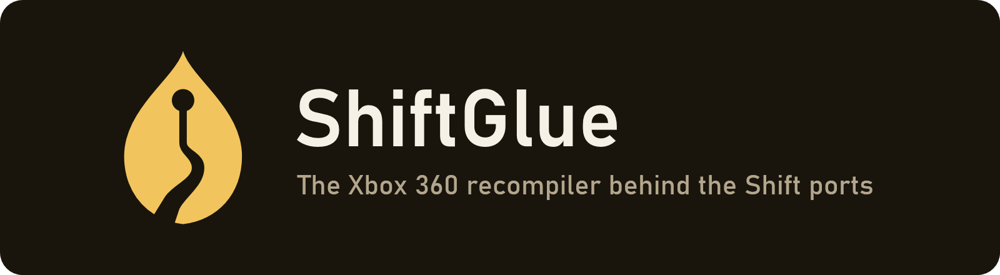

<p align="center">
  
</p>

<p align="center">
  <a href="https://github.com/arcanite24/shiftglue-sdk/stargazers"></a>
  <a href="LICENSE"></a>
  <a href="https://github.com/rexglue/rexglue-sdk"></a>
</p>

ShiftGlue is a fork of [ReXGlue](https://github.com/rexglue/rexglue-sdk). Like ReXGlue, it converts
Xbox 360 PowerPC code into portable C++ ahead of time and supplies the runtime the result runs on:
kernel, graphics, audio and input. ShiftGlue is the framework under the Shift ports, and most of its
changes came from making those games run well on desktops, handhelds, Macs and Android phones.

| Port | Game (Xbox 360) | ShiftGlue branch |
| --- | --- | --- |
| [Pinyon Shift](https://github.com/arcanite24/pinyon-shift) | Forza Horizon | `main` |
| [Lavender Shift](https://github.com/arcanite24/lavender-shift) | Forza Horizon 2 | `main` |
| [Cobalt Shift](https://github.com/arcanite24/cobalt-shift) | Forza Motorsport 3 | `cobalt` |

> [!CAUTION]
> ShiftGlue changes quickly and its API breaks without notice. It is not a ReXGlue release: for
> ReXGlue's own builds, documentation and support, go to the upstream project.

## What the fork adds

- **Platforms.** An Android arm64 target (Vulkan, Adreno drivers loaded through adrenotools, Mali
  workarounds, HDR10); fixes and tuning for Apple silicon Macs on MoltenVK, including guest memory on
  16 KiB host pages; 2 MiB pages for game code on Linux and thread pinning for the Steam Deck.
- **A Vulkan renderer for small GPUs.** An on-disk shader cache, ahead-of-time pipeline lists, opt-in
  bindless textures, texture size caps, and render scale, MSAA and texture size that change without a
  restart.
- **Upscaling and frame generation.** DLSS and FSR 2/3 temporal upscaling fed with the title's depth,
  motion vectors and a frame without the HUD; FSR 3.1, DLSS and LSFG 3.1 frame generation (LSFG loads
  the player's own `Lossless.dll`).
- **Display.** HDR output to an scRGB swapchain, ambient occlusion at present, texture replacement
  packs, and HUD scaling with a safe zone.
- **Input and audio.** DualSense triggers, lightbar and tilt steering; racing wheels driven by the
  title's own force feedback; SDL controller mappings built from raw input; key bindings with
  modifiers; the player's own music as the console's music player.
- **Code generation.** Opt-in native regions compiled into one host function, checked against an independent
  interpreter and a lockstep verifier; loads from read-only image data folded into literals; RTTI class
  export (`classes.json`); more PowerPC instructions; ABI poison checks around guest calls.
- **Diagnostics.** Session and frame replay, frame inspection snapshots, draw and lock censuses, and
  GPU profiles broken down by pass.

Some of these paths are written for the Forza Horizon renderer; their settings and code are named
`fh1`.

## Using it

ShiftGlue has no standalone releases. Each port pins a ShiftGlue commit as a git submodule and builds
it with its own setup tool, which is the easiest way to get a working build.

To build the SDK on its own, use the CMake presets:

```sh
cmake --preset win-amd64
cmake --build --preset win-amd64-release
```

Presets exist for `win-amd64`, `win-arm64`, `linux-amd64`, `linux-arm64`, `mac-amd64` and
`mac-arm64`. Android builds go through the NDK toolchain of the port that uses them. Build
prerequisites, the codegen CLI and the config file are described on
[ReXGlue's wiki](https://github.com/rexglue/rexglue-sdk/wiki). It is written for upstream and the fork
has diverged since, so some details differ.

## Reporting problems

Issues are turned off on this repository. Report problems on the tracker of the port you are using,
for example [Pinyon Shift's issues](https://github.com/arcanite24/pinyon-shift/issues). Pull requests
are welcome here.

## Upstream

ShiftGlue's `main` does not mirror ReXGlue. Upstream changes arrive through merges, so the fork can
trail ReXGlue's latest release. ReXGlue's [releases](https://github.com/rexglue/rexglue-sdk/releases),
wiki and [Discord server](https://discord.gg/CNTxwSNZfT) belong to the upstream project.

# Disclaimer

ShiftGlue is not affiliated with or endorsed by Microsoft, Xbox, Playground Games, Turn 10 Studios or
the ReXGlue project. It is an independent project created for educational and development purposes.
All trademarks and copyrights belong to their respective owners.

This project is not intended to promote piracy nor unauthorized use of copyrighted material. It
contains no game code or data; the ports need the player's own copy of each game. Any misuse of this
software to endorse or enable this type of activity is strictly prohibited.

# Licence

BSD 3-Clause, the same as ReXGlue; see [LICENSE](LICENSE). Portions are derived from the Xenia
project.

# Credits

## ShiftGlue
- [arcanite24](https://github.com/arcanite24) - Fork maintainer
- [tycrowther](https://github.com/tycrowther), [rosscarlson](https://github.com/rosscarlson),
  [XpartFS](https://github.com/XpartFS), [MoaazHF](https://github.com/MoaazHF) - Contributors

## ReXGlue
- [Tom (crack)](https://github.com/tomcl7) - Project Founder
- [Loreaxe](https://github.com/Loreaxe) - Linux Contributor
- [mystixor](https://github.com/Mystixor) - Windows Contributor
- [Graine25](https://github.com/Graine25) - Project Support
- [Carlos Estrague (mrcmunir)](https://github.com/mrcmunir) - Linux / ARM64 Contributor
- [sanjay900](https://github.com/sanjay900) - Linux / SDL Contributor
- [Toby](https://github.com/TbyDtch) - Project Support
- [Roxxsen](https://github.com/Roxxsen) - CI/CD Contributor

The list above is not exhaustive. Thanks to everyone in the ReXGlue community who contributes code, files issues, tests builds, and keeps the project moving.

## Very Special Thank You:
- [Project Xenia](https://github.com/xenia-project/xenia/tree/master/src/xenia) - Their invaluable work on Xbox 360 emulation laid the groundwork for ReXGlue's development. This project (and numerous others) would not exist without their hard work and dedication.
- [XenonRecomp](https://github.com/hedge-dev/XenonRecomp) - For pioneering the modern static recompilation approach for Xbox 360. A lot of the codegen analysis logic and instruction translations are based on their work. Thank you!
- [rexdex's recompiler](https://github.com/rexdex/recompiler) - The OG static recompiler for Xbox 360. 
- Many others in the Xbox 360 homebrew and modding communities whose work and research have contributed to the collective knowledge that makes projects like this possible.
